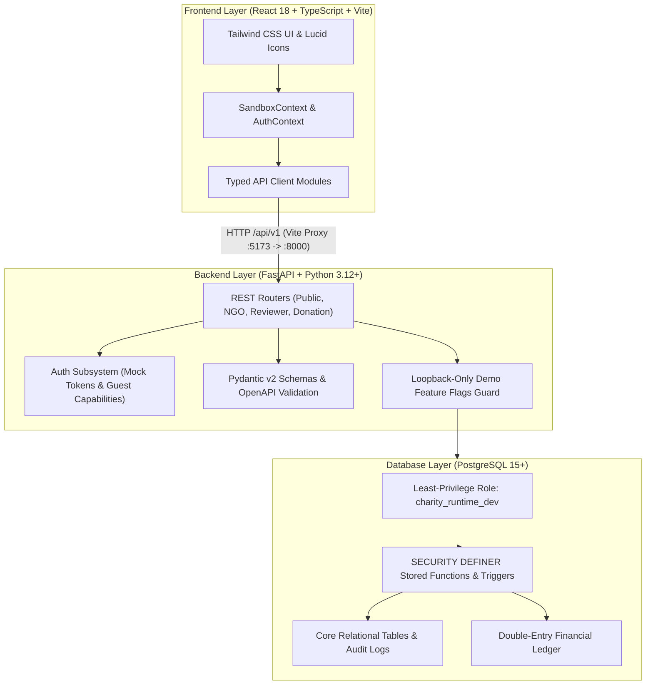

# DonateKaro: Charity Donation & Beneficiary Management Portal

[](https://fastapi.tiangolo.com)
[](https://react.dev)
[](https://www.typescriptlang.org)
[](https://www.postgresql.org)
[](https://tailwindcss.com)
[](https://vitejs.dev)

A full-stack, database-centric charity fundraising and beneficiary management prototype built as a **Problem-Based Learning (PBL)** project for **B.Tech CSE Semester III, Database Management Systems (CSL0311)**.

DonateKaro provides robust multi-tenant organization onboarding, campaign lifecycle governance, donor engagement, simulated payment settlement, and double-entry ledger fund accounting with institutional oversight.

---

> [!IMPORTANT]
> **Academic Prototype & Simulated Payment Notice:**<br />
> This software is an academic demonstration and research prototype. Authentication uses scoped mock tokens and sandbox capability keys. **All payment processing is strictly simulated** — no real banking gateways, credit card processing, or financial transactions take place.

---

## Table of Contents

1. [Key Features & Core Workflows](#key-features--core-workflows)
2. [Architecture & Technology Stack](#architecture--technology-stack)
3. [Repository Structure](#repository-structure)
4. [Prerequisites](#prerequisites)
5. [Database Setup & Migrations](#database-setup--migrations)
6. [Backend Setup (FastAPI)](#backend-setup-fastapi)
7. [Frontend Setup (React + Vite)](#frontend-setup-react--vite)
8. [Testing & Quality Verification](#testing--quality-verification)
9. [API Documentation & Contracts](#api-documentation--contracts)
10. [Authentication & Simulated Payment Model](#authentication--simulated-payment-model)
11. [Academic Artifacts & Design Decisions](#academic-artifacts--design-decisions)
12. [Known Limitations & Security Caveats](#known-limitations--security-caveats)

---

## Key Features & Core Workflows

### 1. Multi-Tenant Organization Lifecycle
- **Self-Service Registration:** NGOs register with name, government registration reference, email, and phone without pre-existing platform accounts.
- **Applicant Capability Key:** On registration, a cryptographically hashed capability token (`dk_app_<hash>`) is issued to the applicant for workspace resumption.
- **Reviewer Verification Gate:** Reviewers inspect applicant credentials in the Reviewer Workspace before the organization is verified. Campaigns cannot be published until the organization status is `VERIFIED`.

### 2. Campaign Lifecycle Governance & Oversight
- **Draft & Submission:** Verified NGOs create, save, and refine campaign drafts. Submissions are checked for completeness (title, purpose, target, dates, and description).
- **Institutional Review Board (IRB) Approval:** Submissions enter the IRB audit queue with reviewer separation guards (a user cannot review their own organization's campaigns).
- **Public Discovery:** Active, approved campaigns within valid date windows are dynamically published to the homepage carousel and public catalog.
- **Closure Governance:** NGOs can formally submit closure requests with justified reasons.
- **IRB Oversight Controls:** Reviewers can temporarily suspend active campaigns (instantly hiding them from public discovery and pausing donations), reopen suspended campaigns, or permanently close campaigns with full audit logging.

### 3. Financial Integrity & Simulated Donations
- **Double-Entry Ledger Architecture:** Every cleared donation creates balanced debit and credit entries in the database ledger (`DONATION_RECEIVED` / `RESTRICTED_FUNDS_LIABILITY`).
- **Simulated Payment Gateway:** Donors experience an interactive payment simulation (Card, UPI, NetBanking) with deterministic outcome simulation (`SUCCEEDED`, `FAILED`, `CANCELLED`).
- **Cryptographic Guest Access:** Unregistered donors receive scoped capability tokens (`min_length=43`) to safely inspect receipt status without platform account creation.
- **Idempotency Safeguards:** Strict UUIDv4 idempotency keys ensure network retries never produce duplicate charges or ledger discrepancies.

### 4. Interactive Academic Frontend
- **Dual Runtime Modes:** Seamlessly toggles between **Live API Mode** (connected to FastAPI and PostgreSQL) and **Sandbox Mode** (in-memory mock store for offline demonstration).
- **Desktop Hero & Cause Carousel:** Wide desktop layout displaying 6 visible campaign tiles with progress tracking, cause filtering, and responsive fallback imagery.

---

## Architecture & Technology Stack



- **Frontend:** React 18, TypeScript 5.5, Vite 5.4, Tailwind CSS 3.4, Vitest, Testing Library.
- **Backend:** FastAPI 0.115, Python 3.12/3.14 (CPython), Pydantic v2, PyJWT, psycopg / PostgreSQL native drivers.
- **Database:** PostgreSQL 15+ (tested on PostgreSQL 18.6), PL/pgSQL stored procedures, triggers, audit logging, and row-level role security.
- **API Specification:** OpenAPI 3.1 (`contracts/openapi.yaml`).

---

## Repository Structure

```
charity-donation-beneficiary-portal/
├── backend/                  # FastAPI REST API implementation
│   ├── app/                  # Application packages
│   │   ├── api/              # Route handlers (campaigns, donations, ngo, reviewer)
│   │   ├── auth.py           # Authentication, mock-principal & capability gates
│   │   ├── config.py         # Loopback safety checks & configuration settings
│   │   ├── database.py       # Connection pooling & context management
│   │   ├── errors.py         # Standardized RFC 7807 problem details
│   │   ├── schemas.py        # Pydantic v2 request/response contracts
│   │   └── workflow_repository.py # Database procedure binding layer
│   ├── tests/                # Pytest integration & contract test suite
│   ├── pyproject.toml        # Backend dependencies & tool configuration
│   └── README.md             # Backend-specific architecture reference
├── database/                 # PostgreSQL physical artifacts & migrations
│   ├── schema.sql            # Base schema (tables, constraints, indexes)
│   ├── workflows.sql         # Base PL/pgSQL stored procedures & triggers
│   ├── runtime-roles.sql     # Least-privilege runtime user grants
│   ├── migrations/           # Incremental schema evolution scripts
│   │   ├── m001_ngo_lifecycle.sql
│   │   ├── m002_functions_only.sql
│   │   └── m003_campaign_closure_and_oversight.sql
│   └── seed/
│       └── demo_data.sql     # Deterministic demo dataset with cleared ledger
├── frontend/                 # React 18 + Vite frontend
│   ├── src/
│   │   ├── api/              # API clients for Live API & in-memory Mock store
│   │   ├── components/       # Common navigation, headers, footers
│   │   ├── context/          # SandboxContext (Live/Mock) & AuthContext
│   │   ├── features/         # Workspaces: Home, Donation, NGO, Reviewer, About
│   │   ├── test/             # Vitest frontend integration & unit tests
│   │   └── types/            # TypeScript API contract definitions
│   ├── package.json          # Frontend dependencies & scripts
│   └── vite.config.ts        # Vite configuration & backend proxy rules
├── contracts/
│   └── openapi.yaml          # Authoritative OpenAPI 3.1 specification
├── docs/                     # Academic deliverables, design decisions, ER diagrams
├── presentation/             # Presentation outlines and visual schema SVG files
├── tests/                    # Database-level test plans & SQL integrity scripts
├── .gitignore                # Repository-wide ignore rules
├── LOCAL_SETUP.md            # Detailed step-by-step local runtime setup guide
└── README.md                 # Primary project documentation (this file)
```

---

## Prerequisites

Ensure the following tools are installed on your workstation:

| Prerequisite | Recommended Version | Purpose |
|---|---|---|
| **PostgreSQL** | 14, 15, 16, or 18+ | Primary relational DBMS with `psql` client |
| **Python** | 3.12+ (CPython) | Backend API server |
| **Node.js** | 18+ (LTS) | Frontend tooling and development server |
| **npm** | 9+ | Package manager for frontend dependencies |

---

## Database Setup & Migrations

### 1. Initialize Database & Runtime User
Open a PostgreSQL superuser prompt (`psql` or `pgAdmin`):

```sql
CREATE DATABASE charity_portal_dev;
CREATE USER charity_runtime_dev WITH PASSWORD 'devruntime123';
```

### 2. Apply Base Schemas, Workflows, and Roles
Execute in order against `charity_portal_dev`:

```bash
# Set PostgreSQL connection variables (adjust for your environment)
export PGPASSWORD="your_postgres_password"
DB="charity_portal_dev"

# 1. Base tables, constraints, and indexes
psql -h 127.0.0.1 -p 5432 -U postgres -d $DB -f database/schema.sql

# 2. Base stored procedures, triggers, and audit routines
psql -h 127.0.0.1 -p 5432 -U postgres -d $DB -f database/workflows.sql

# 3. Apply least-privilege role permissions
psql -h 127.0.0.1 -p 5432 -U postgres -d $DB -f database/runtime-roles.sql
```

### 3. Apply Incremental Migrations
```bash
# 4. NGO lifecycle registration & verification columns
psql -h 127.0.0.1 -p 5432 -U postgres -d $DB -f database/migrations/m001_ngo_lifecycle.sql

# 5. Updated stored functions
psql -h 127.0.0.1 -p 5432 -U postgres -d $DB -f database/migrations/m002_functions_only.sql

# 6. Campaign closure requests and IRB oversight actions
psql -h 127.0.0.1 -p 5432 -U postgres -d $DB -f database/migrations/m003_campaign_closure_and_oversight.sql
```

### 4. Seed Deterministic Demo Data
```bash
# 7. Seed organizations, campaigns across purpose codes, double-entry donations
psql -h 127.0.0.1 -p 5432 -U postgres -d $DB -f database/seed/demo_data.sql
```

---

## Backend Setup (FastAPI)

### 1. Virtual Environment & Dependencies
```bash
cd backend
python -m venv .venv

# On Linux/macOS:
source .venv/bin/activate

# On Windows PowerShell:
.\.venv\Scripts\Activate.ps1

pip install -r requirements.txt   # or: pip install -e ".[test]"
```

### 2. Run FastAPI Server
Set local environment variables enabling demo workflows and run with Uvicorn:

**PowerShell (Windows):**
```powershell
$env:CHARITY_ENVIRONMENT = 'test'
$env:CHARITY_DATABASE_URL = 'host=127.0.0.1 port=5432 dbname=charity_portal_dev user=charity_runtime_dev'
$env:CHARITY_WORKFLOWS_ENABLED = 'true'
$env:CHARITY_DONATION_WRITES_ENABLED = 'true'
$env:CHARITY_SIMULATED_PAYMENTS_ENABLED = 'true'

python -m uvicorn app.main:app --app-dir backend --host 127.0.0.1 --port 8000 --reload
```

**Bash (Linux / macOS):**
```bash
export CHARITY_ENVIRONMENT="test"
export CHARITY_DATABASE_URL="host=127.0.0.1 port=5432 dbname=charity_portal_dev user=charity_runtime_dev"
export CHARITY_WORKFLOWS_ENABLED="true"
export CHARITY_DONATION_WRITES_ENABLED="true"
export CHARITY_SIMULATED_PAYMENTS_ENABLED="true"

python -m uvicorn app.main:app --app-dir backend --host 127.0.0.1 --port 8000 --reload
```

The API will be available at: **http://127.0.0.1:8000**<br />
Interactive OpenAPI documentation: **http://127.0.0.1:8000/docs**

---

## Frontend Setup (React + Vite)

### 1. Install Dependencies
```bash
cd frontend
npm install
```

### 2. Start Vite Development Server
```bash
npm run dev
```

The frontend application will be served at: **http://localhost:5173**<br />
API requests to `/api` are automatically proxied to `http://localhost:8000` via `vite.config.ts`.

---

## Testing & Quality Verification

All layers are verified with automated test suites:

### 1. Backend Pytest Suite
Verifies API contract adherence, financial write gates, loopback guards, Pydantic serialization, and authorization gates:

```bash
# Ensure demo flags are unset for clean verification of fail-closed gates:
pytest backend/tests -v
```
**Expected result:** `58 passed, 1 skipped` (the skipped test is the isolated full lifecycle acceptance test requiring explicit database URL).

### 2. Frontend Vitest Suite
Verifies UI component rendering, state transitions, hero carousel tiles, donation wizard steps, and API client mapping:

```bash
cd frontend
npm test -- --run
```
**Expected result:** `95 passed (10 test files)`

### 3. Frontend Typecheck & Production Build
```bash
cd frontend
npm run typecheck    # Runs tsc --noEmit (0 errors)
npm run build        # Production bundle check (built cleanly in ~2s)
```

---

## API Documentation & Contracts

The authoritative OpenAPI specification is maintained in [`contracts/openapi.yaml`](contracts/openapi.yaml).

### Key Endpoint Groups

| Method | Endpoint | Authorization | Description |
|---|---|---|---|
| `GET` | `/api/v1/campaigns` | Public | Paginated list of active campaigns accepting donations |
| `GET` | `/api/v1/campaigns/{id}` | Public | Full campaign detail by ID |
| `POST` | `/api/v1/donations` | Guest capability / Bearer | Create a new pending donation with idempotency key |
| `POST` | `/api/v1/donations/{id}/simulated-payment` | Guest / Bearer | Execute simulated payment attempt |
| `POST` | `/api/v1/organizations/register` | Public | Register new NGO & receive applicant token |
| `GET` | `/api/v1/organizations/{id}/campaigns` | Scoped Org Member | List drafts and campaigns for an organization |
| `POST` | `/api/v1/campaigns/{id}/closure-request` | Scoped Org Member | Request formal campaign closure |
| `GET` | `/api/v1/review/queue` | `CAMPAIGN_REVIEWER` | List submitted campaigns awaiting IRB review |
| `POST` | `/api/v1/review/campaigns/{id}/decision` | `CAMPAIGN_REVIEWER` | Approve or reject a campaign draft |
| `GET` | `/api/v1/review/all-campaigns` | `CAMPAIGN_REVIEWER` | IRB oversight list across all lifecycle states |
| `POST` | `/api/v1/review/campaigns/{id}/suspend` | `CAMPAIGN_REVIEWER` | Temporarily suspend an active campaign |
| `POST` | `/api/v1/review/campaigns/{id}/reopen` | `CAMPAIGN_REVIEWER` | Reopen a suspended campaign |
| `POST` | `/api/v1/review/campaigns/{id}/close` | `CAMPAIGN_REVIEWER` | Permanently close a campaign (audit logged) |
| `GET` | `/api/v1/review/closure-requests` | `CAMPAIGN_REVIEWER` | List NGO closure requests for review |
| `POST` | `/api/v1/review/closure-requests/{id}/decision` | `CAMPAIGN_REVIEWER` | Approve or reject closure request |

---

## Authentication & Simulated Payment Model

### Mock Authentication Roles (Development Mode)
When running with `CHARITY_ENVIRONMENT=test`, the backend recognizes designated test bearer tokens:

| Token | Mock Principal | Role & Scope |
|---|---|---|
| `mock-ngo-editor` | `mock:bal-vikas-editor` | `CAMPAIGN_EDITOR` on Organization 2 |
| `mock-irb-reviewer` | `mock:irb-faculty-reviewer` | `CAMPAIGN_REVIEWER` platform role |
| `dk_app_<token>` | `applicant:<sha256>` | Scoped applicant access for registered NGO |

> **Security Rule:** Mock token resolution is strictly compiled out when `CHARITY_ENVIRONMENT` is set to `staging` or `production`.

### Simulated Payment Architecture
- No card numbers, CVVs, or bank credentials are ever transmitted or stored.
- Payments transition through explicit database states: `PENDING` → `SUCCEEDED` / `FAILED` / `CANCELLED`.
- Cleared donations automatically trigger double-entry ledger postings inside PostgreSQL transactions via SECURITY DEFINER stored procedures.

---

## Academic Artifacts & Design Decisions

This repository includes comprehensive academic and architectural documentation:

- **Database ER Model:** [`docs/er-model.md`](docs/er-model.md) & visual SVG [`docs/er-model-abstracted.svg`](docs/er-model-abstracted.svg)
- **Relational Schema & Dictionary:** [`docs/relational-schema.md`](docs/relational-schema.md) & visual diagram [`docs/relational-schema-abstracted.svg`](docs/relational-schema-abstracted.svg)
- **Database Normalization (1NF to BCNF):** [`docs/normalization-worksheet.md`](docs/normalization-worksheet.md)
- **Financial Integrity & Double-Entry Design:** [`docs/design-decisions.md`](docs/design-decisions.md)
- **Mid-Evaluation Report:** [`docs/mid-evaluation-report.md`](docs/mid-evaluation-report.md)
- **DevOps & Verification Notes:** [`docs/database-devops.md`](docs/database-devops.md) and [`docs/verification-notes.md`](docs/verification-notes.md)

---

## Known Limitations & Security Caveats

1. **Authentication:** The prototype uses scoped synthetic tokens for evaluation. Real-world deployment requires production OIDC/OAuth 2.0 PKCE providers.
2. **Payment Processing:** Payments are completely simulated. Integrating live payment rails requires PCI-DSS compliance, webhooks with signature verification, and gateway reconciliation.
3. **Email & Notifications:** Outbound notifications (receipt emails, verification alerts) are stubbed or displayed inline.
4. **Beneficiary & Disbursement Subsystems:** Database schemas, constraints, and stored procedures for beneficiary verification and disbursement exist in `schema.sql` and `workflows.sql`; user-facing management UI for disbursements is outside this PBL prototype's evaluation scope.
5. **Irreversibility of Closure:** Campaign closure (`CLOSED`) is terminal by design. A closed campaign cannot be reopened, preserving financial records and ledger integrity.

---

## Academic Information

- **Course:** Database Management Systems (DBMS)
- **Course Code:** CSL0311
- **Programme:** B.Tech Computer Science & Engineering
- **Semester:** III
- **Project Paradigm:** Problem-Based Learning (PBL)
