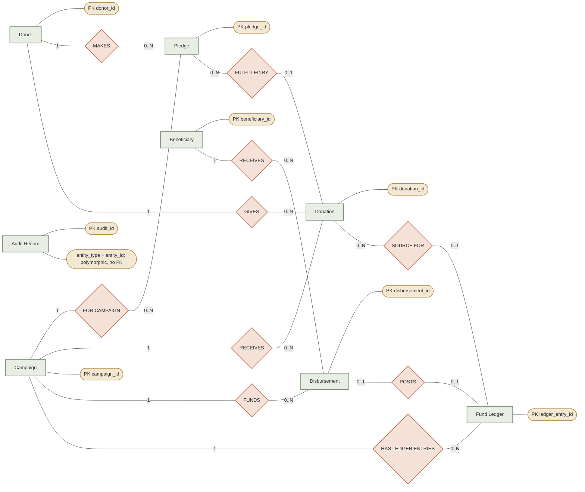

# DonateKaro Abstracted ER Model

This conceptual view complements the complete physical ER model in [`er-model.md`](er-model.md) and the presentation-level full model in [`presentation/er-model-extracted.md`](../presentation/er-model-extracted.md). It is intentionally limited to eight meaningful business concepts from the current implementation. It does not claim that the database has only these entities.

## Chen-style Mermaid diagram

This is a single connected Chen-style view: entities use rectangles, relationships use diamonds, and attributes use ovals. Primary identifiers are marked `PK`. Cardinalities are written beside each relationship end. Audit Record is intentionally isolated because its polymorphic entity reference is not enforced by a foreign key.

## Reading the relationships

- **Donor–Pledge:** `donor_id` is required on each pledge, so each pledge has one donor; a donor may have zero or many pledges.
- **Campaign–Pledge:** each pledge has one campaign; a campaign may have zero or many pledges.
- **Donor–Donation:** `donor_id` is required on each donation; a donor may have zero or many donations.
- **Campaign–Donation:** each donation has one campaign; a campaign may have zero or many donations.
- **Pledge–Donation:** `donation.pledge_id` is nullable and not unique. A donation may be unpledged or link to one pledge; a pledge may be fulfilled through zero or many donations. Clearing and refund workflows derive pledge status from net received donations. A pledge is a promise, not money received.
- **Campaign–Disbursement:** each disbursement has one campaign; a campaign may have zero or many disbursements.
- **Beneficiary–Disbursement:** each disbursement targets one beneficiary; a beneficiary may be linked to zero or many disbursements. The payment workflow requires beneficiary verification.
- **Campaign–Fund Ledger:** every ledger entry has a campaign FK; a campaign may have zero or many ledger entries.
- **Donation–Fund Ledger:** the ledger's donation FK is nullable and non-unique. Donation clearing and refund ledger rows can reference a donation; a ledger entry may instead represent a disbursement. Thus each ledger entry has zero or one donation source, while a donation can be associated with multiple ledger entries.
- **Disbursement–Fund Ledger:** the ledger's disbursement FK is nullable and a partial unique index allows at most one payout ledger event per disbursement. Declarative cardinality is optional one-to-one; the paid workflow writes the event atomically with the payment-state change.

## Mapping to physical tables

| Abstract entity | Physical table | Abstraction note |
|---|---|---|
| Donor | `donor` | Anonymous-record flag and donor contact fields remain physical details. |
| Campaign | `campaign` | The physical campaign also has required FKs to `organization` and `purpose_category`; those supporting entities are omitted from this eight-entity view. |
| Donation | `donation` | Original donation is retained. Refund headers/scopes are in `donation_refund` and `donation_refund_scope`, and refund reversals are also recorded in `fund_ledger_entry`; these supporting tables are omitted. |
| Pledge | `pledge` | Represents a commitment, not a cleared gift or available balance. |
| Beneficiary | `beneficiary` | Payment eligibility depends on workflow verification. |
| Disbursement | `disbursement` | A separate payment request/state linked to a campaign and beneficiary; it is not an automatic transfer of a donation. |
| Fund Ledger | `fund_ledger_entry` | Each row is one signed event. Donation allocation, restriction, and refund-scope tables provide additional physical detail omitted here. |
| Audit Record | `audit_log` | Records actor/action and textual entity information. `(entity_type, entity_id)` is polymorphic and has no FK to the business entity it describes. |

## Omitted implementation entities

The diagram omits `organization`, `purpose_category`, `fund_restriction`, `donation_restriction`, `donation_refund`, `donation_refund_scope`, and `donor_consent_event` to keep the conceptual view focused. These are present in the physical schema and are covered in the full ER and relational models. The abstraction does not draw a direct Donation–Beneficiary or Donation–Disbursement relationship: the source schema has none. Fund availability and payout are connected through campaign-scoped ledger events and separately guarded disbursement workflows.

## Evidence boundary

This model was derived from repository files `database/schema.sql` and `database/workflows.sql`. No database was accessed, and no live catalog verification is claimed. The Chen-style diagram uses only the actual mandatory/optional FK relationships described above; the audit association is explicitly explanatory and is not represented as a foreign-key relationship.
