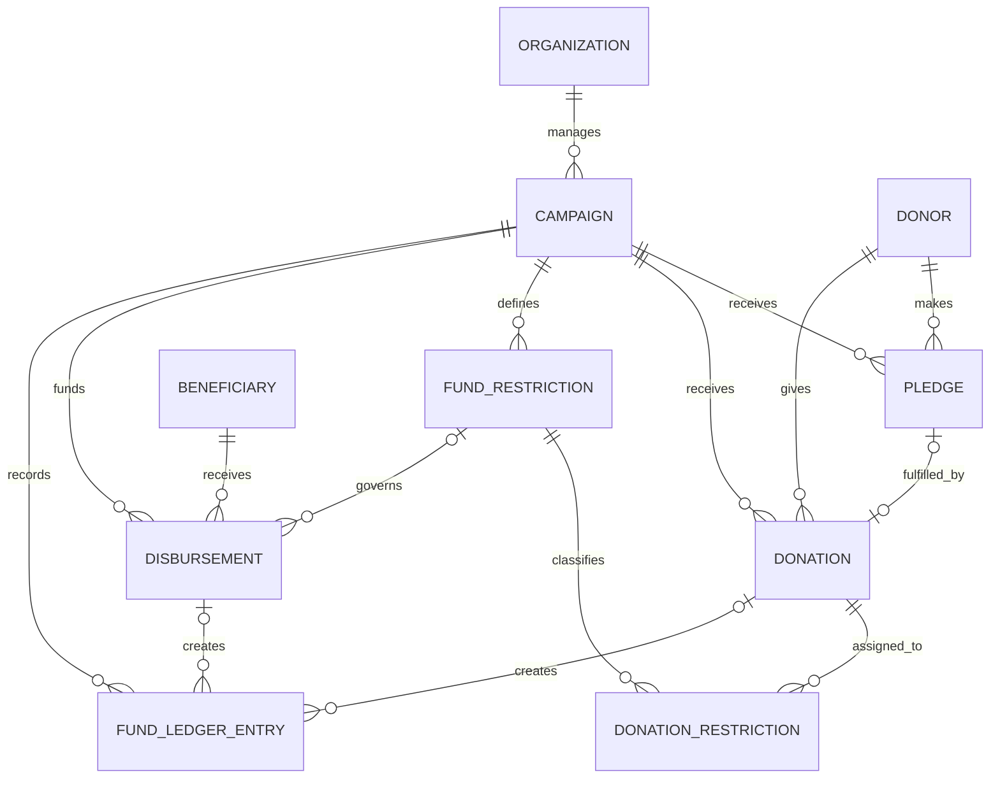

# ER Model

**Status:** Proposed model derived from supplied requirements and README. The README describes eight core entities; this design adds FUND_RESTRICTION, DONATION_RESTRICTION, and FUND_LEDGER_ENTRY to represent restriction-specific accountability and append-style fund movements.

## Conceptual ER diagram

Audit Log uses a polymorphic `(entity_type, entity_id)` reference in this design, so it is conceptually associated with relevant entities but these are not enforceable foreign keys.

## Main entities and purpose

- **Donor:** named or explicitly anonymous donor record and donor consent history references.
- **Organization:** responsible organization for campaigns.
- **Campaign:** purpose, target, schedule, approval status, and operational status.
- **Pledge:** amount promised by a donor; does not create spendable funds.
- **Donation:** actual payment and its status, unique transaction reference/receipt, clearing and refund metadata.
- **Beneficiary:** beneficiary profile plus verification status and evidence reference.
- **Disbursement:** amount and purpose paid or intended to be paid to a beneficiary.
- **Audit Log:** action history for consent, approvals, verification, and fund movements.
- **Fund Restriction:** campaign-specific allowed-use category / purpose.
- **Donation Restriction:** associative entity that assigns a donation amount to a fund restriction.
- **Fund Ledger Entry:** append-style record of clearing, refund, allocation, disbursement, or reversal movements.

## Key cardinality notes

- One organization may manage zero or many campaigns; every campaign has exactly one responsible organization.
- One donor may make many pledges and donations; each pledge/donation references one donor record. Anonymous giving uses a dedicated anonymous donor record.
- A campaign can have many pledges and donations.
- This first model permits at most one donation per pledge. For partial/multiple donation fulfilment, replace the optional unique pledge reference with a PLEDGE_DONATION associative relation.
- A campaign may define many restrictions. A donation may be split across restrictions, hence DONATION_RESTRICTION is M:N.
- A beneficiary may receive many disbursements. Each disbursement is for one beneficiary and one campaign; the restriction is optional for unrestricted funds.
- One source transaction can result in multiple audit/ledger events, such as a clearing entry and a later refund reversal.
