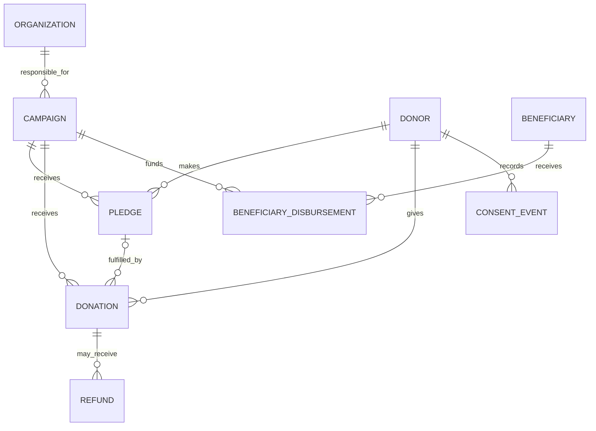
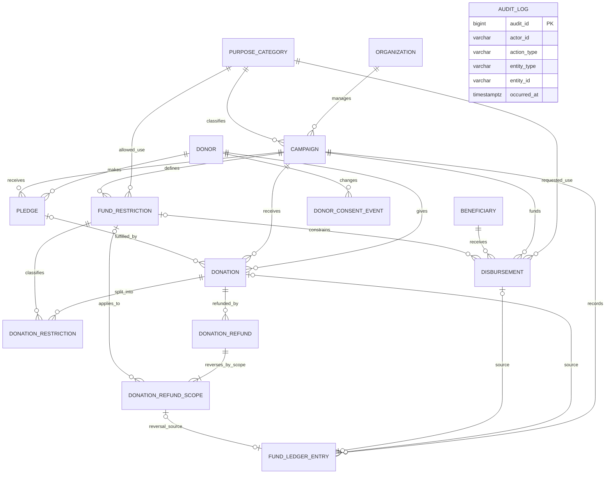

# ER Model

**Status:** Logical design aligned to `database/schema.sql` after the financial-integrity pass. The diagrams are design artifacts and have not yet been compared with a live PostgreSQL catalog.

## Conceptual model: business entities

This model shows business concepts. It omits implementation-only associative and ledger tables.

## Logical model: relational implementation

`AUDIT_LOG` uses a polymorphic `(entity_type, entity_id)` pair. It records events for multiple entity types but has no entity-specific foreign key. The audit writer runs in the same transaction as relevant business operations. Ordinary triggers do not protect this table from owners or superusers.

## Business entity notes

- **Organization:** responsible organization for a campaign.
- **Campaign:** purpose narrative and category, INR target, date window, approval and operational status.
- **Donor:** registered donor or the single explicit anonymous donor row.
- **Pledge:** promise amount, separate from cleared funds; status is derived from net successful donation fulfillment.
- **Donation:** original payment record. It can be linked to zero or one pledge; one pledge may have many donations.
- **Refund:** immutable full or partial refund event linked to its original donation.
- **Fund Restriction:** allowed use category for a campaign-specific fund scope.
- **Disbursement:** approved payment request for a beneficiary and a coded purpose.
- **Consent Event:** append-only grant/revoke history by purpose.

## Implementation relations

- **DONATION_RESTRICTION:** associative rows allocate a donation to restrictions. The campaign ID in the relation lets composite foreign keys enforce that restriction and donation belong to the same campaign. The sum is bounded by the donation under a donation-row lock.
- **DONATION_REFUND_SCOPE:** assigns each refund to the original donation's unrestricted scope (`restriction_id IS NULL`) or a specific restriction. Each amount is tied to exactly one ledger reversal.
- **FUND_LEDGER_ENTRY:** signed INR accounting events for donation clearing, refund, and disbursement. Pledges and requests do not create spendable amounts.
- **AUDIT_LOG:** actor/action/time/entity/change record; actor context comes from the calling application and is an explicit trust assumption.

## Cardinality and normalization notes

- Each campaign belongs to exactly one organization and has one purpose category.
- Each donation belongs to exactly one donor and campaign and optionally one pledge.
- A pledge can have zero or many donations. Successful cleared donation net amounts cannot exceed the pledge amount.
- A donation may have zero or many restricted allocation rows. One donation may also have an unrestricted remainder without a `DONATION_RESTRICTION` row.
- A donation has zero or many refund events; each refund has one or more scope allocations when posted. Refund scopes preserve the original restriction allocation.
- A campaign can define many restrictions; a restriction is only usable in its owning campaign.
- A beneficiary can receive many disbursements. Disbursements reference a campaign and optionally one restriction in that campaign.
- A consent event always references one donor. Audit entity relationships remain polymorphic rather than hard foreign keys.
