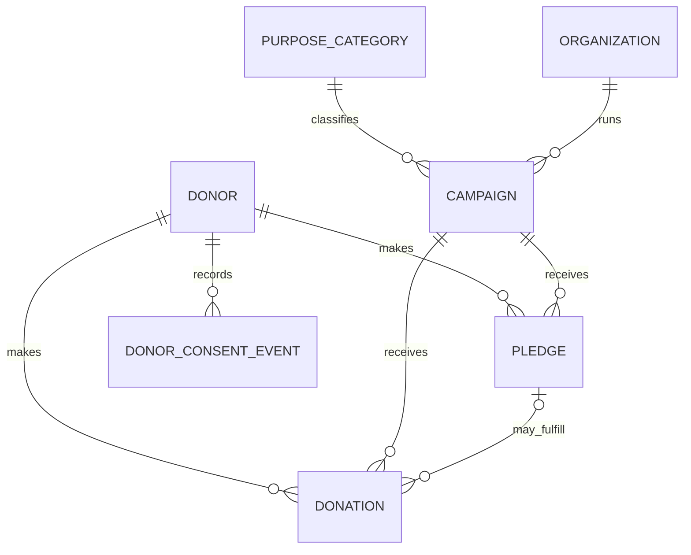
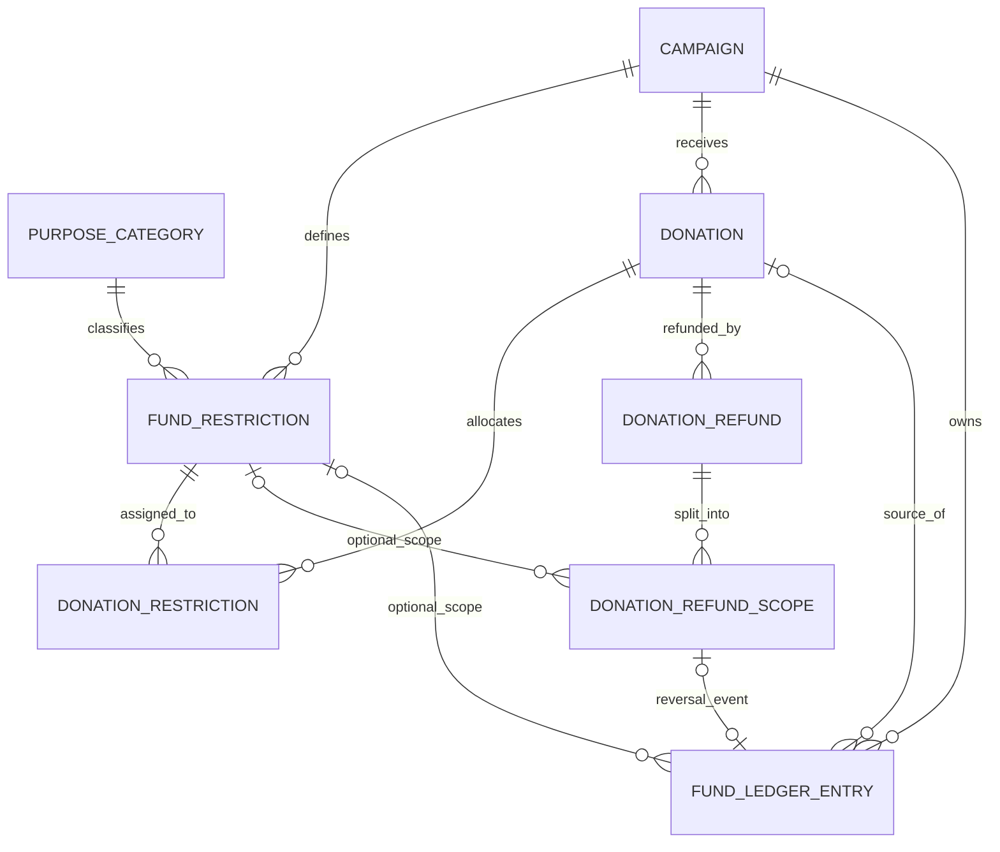
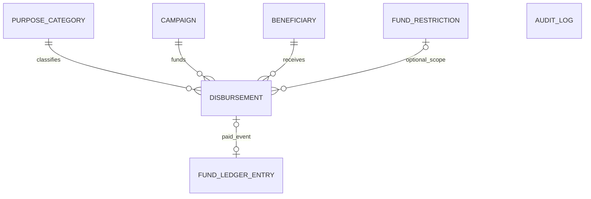

# DonateKaro ER Model — Source Extraction

> Derived from `database/schema.sql` and `database/workflows.sql`; this is a repository-source model, not a live database catalog inspection. The physical schema has 15 tables and 32 declared FK constraints. Lines below represent declared FK relationships only; no undocumented relationship is inferred.

## Notation

The Mermaid crow's-foot notation uses `||` for exactly one, `o|` for zero-or-one, `o{` for zero-or-many, and `|{` for one-or-many. FK declarations prove maximum/required parent references on the child side; the normal `0..many` parent-to-child minimum is a cardinality possibility, not an assertion that rows currently exist. Workflow rules may impose stronger business requirements than the FK alone. Mermaid depicts each logical table pair once where direct and composite FKs reinforce the same relation; the relational companion lists all 32 constraints separately.

## A. People, campaigns, pledges and consent

`PLEDGE o|--o{ DONATION` means a donation may be unpledged, while a pledge may be fulfilled by multiple donations. No unique constraint limits a pledge to one donation. Pledge status is workflow-derived from net cleared donations less refunds.

## B. Restrictions, refund scopes and ledger events

`DONATION_RESTRICTION` is the associative table for donation↔restriction allocation. Composite FKs require that the donation, restriction and stored campaign agree. `DONATION_REFUND_SCOPE.restriction_id` is nullable: NULL represents the unrestricted scope. One refund may have several scope rows; successful workflow processing writes a compensating ledger entry for each reversed scope. The ledger is append-oriented; the available amount is derived by signed sum per campaign/restriction scope.

The diagram shows `FUND_LEDGER_ENTRY`'s source-donation FK as nullable and one-to-many from donation; source checks limit which source columns are populated for a given entry type. A refund scope can have at most one ledger event through the unique nullable `refund_scope_id`; the successful refund workflow expects one. That minimum is workflow behavior, not a declarative lower bound.

## C. Disbursement, purpose and audit

The disbursement's restriction is optional, but if present it must belong to the same campaign. A disbursement has at most one ledger payout event due to the partial unique index; an unpaid disbursement may have none. The ledger's source and sign checks distinguish disbursement entries from donation clearing/refund entries.

`AUDIT_LOG` is intentionally shown without relationship lines. Its `entity_type`/`entity_id` columns are polymorphic text and no FK is declared. Connecting it to every entity would imply referential constraints that do not exist.

## D. Complete entity inventory

Each of the 15 physical tables appears in the diagrams above:

| Table | ER role |
|---|---|
| `purpose_category` | Controlled purpose lookup for campaigns, restrictions and disbursements |
| `organization` | Campaign-owning organization |
| `donor` | Donation/pledge source and consent-event parent; includes anonymous-record flag |
| `campaign` | Central fundraising and payout scope |
| `pledge` | Donor's promised amount; may link to multiple donations |
| `donation` | Original donation record; optional pledge; may be split across restrictions |
| `beneficiary` | Disbursement recipient; payment requires verified state in workflow |
| `fund_restriction` | Campaign-specific restriction tied to a purpose code |
| `donation_restriction` | Donation-to-restriction allocation junction |
| `donation_refund` | Refund header linked to original donation |
| `donation_refund_scope` | Per-restriction or unrestricted portion of a refund |
| `disbursement` | Campaign payout request and payment state |
| `audit_log` | Append-only audit events with polymorphic text entity reference |
| `fund_ledger_entry` | Signed clearing, refund, and payout events |
| `donor_consent_event` | Append-only consent history linked to donor |

## Relationship and integrity notes

1. **Required parents:** every campaign has exactly one organization and purpose category; every pledge has one donor and campaign; every donation has one donor and campaign; every restriction has one campaign and purpose category; every refund has one donation and matching campaign; every disbursement has one campaign, beneficiary and purpose category; every consent event has one donor; each ledger row has one campaign.
2. **Optional parents:** donation→pledge, disbursement→restriction, refund-scope→restriction, and ledger source/scope references are nullable as declared. NULL restriction in a refund scope/ledger denotes unrestricted money; the exact source check determines which ledger references apply to each event kind.
3. **Many-to-many:** donation and restriction are related through `donation_restriction`. Composite FKs enforce same-campaign scope. Workflow triggers additionally enforce aggregate allocation not exceeding donation amount and prevent changing allocations after clearing.
4. **Refunds:** one donation may have multiple refund headers; one refund may have multiple scope rows. The workflow reverses scopes in ascending restriction ID, unrestricted last, and does not borrow across a scope's available balance. Scope-total and ledger effects are workflow transaction behavior, not fully represented by FK cardinality alone.
5. **Pledges:** one pledge may be linked from zero or many donations. Cleared net donation amount determines `OPEN`, `PARTIALLY_FULFILLED`, or `FULFILLED`; pledge rows do not represent cash.
6. **Ledger:** campaign is required; restriction and source references are nullable at the column level, with composite FKs and a `CHECK` defining valid source combinations. Signed amounts encode inflow/outflow; balances are derived, not stored in a balance table.
7. **Audit:** `audit_log` has no FK to business entities. Actor identity is supplied through `app.actor_id`; the trigger checks presence, not authentication. Database owner/superuser privileges can bypass trigger protections.
8. **Purpose classification:** the purpose lookup constrains code existence, and workflow checks code compatibility for payouts. It cannot prove actual legal use or expenditure purpose.
9. **Referential actions:** no `ON DELETE`/`ON UPDATE` action is declared; PostgreSQL default `NO ACTION` applies. The workflow layer additionally rejects selected history mutation operations, but triggers do not protect against privileged owners/superusers.

## Source verification boundary

This model was cross-referenced against repository files `database/schema.sql` and `database/workflows.sql`, together with the staged relational/ER documentation and the repository's design-decision, test-plan, and execution-report records. The pre-existing `docs/er-model.md` and `docs/relational-schema.md` are staged milestone files and were not edited. No SQL was executed and no database was accessed while producing this extracted model.
